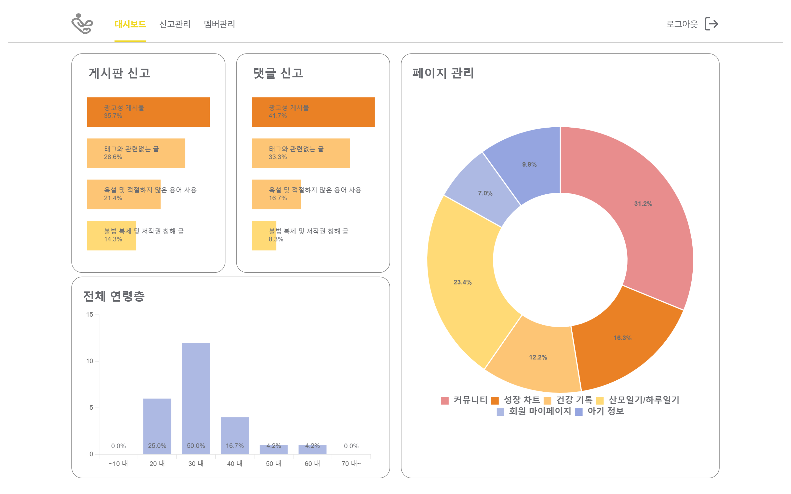
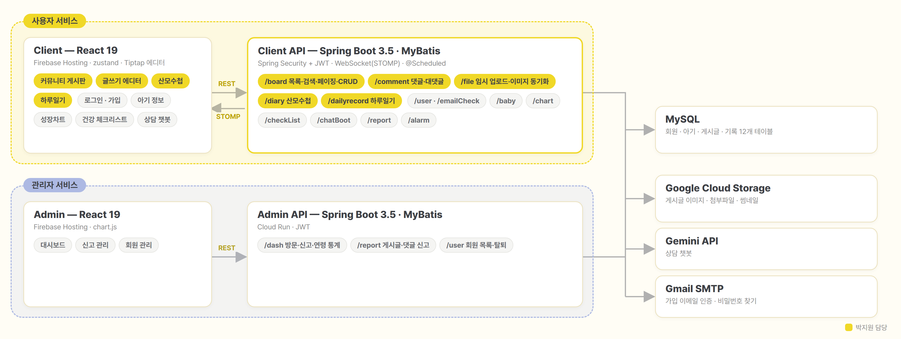
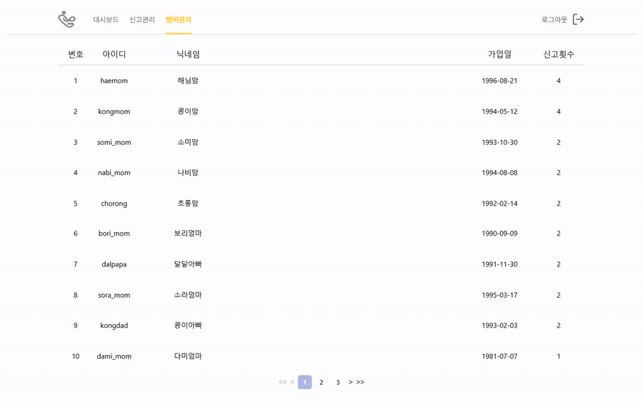
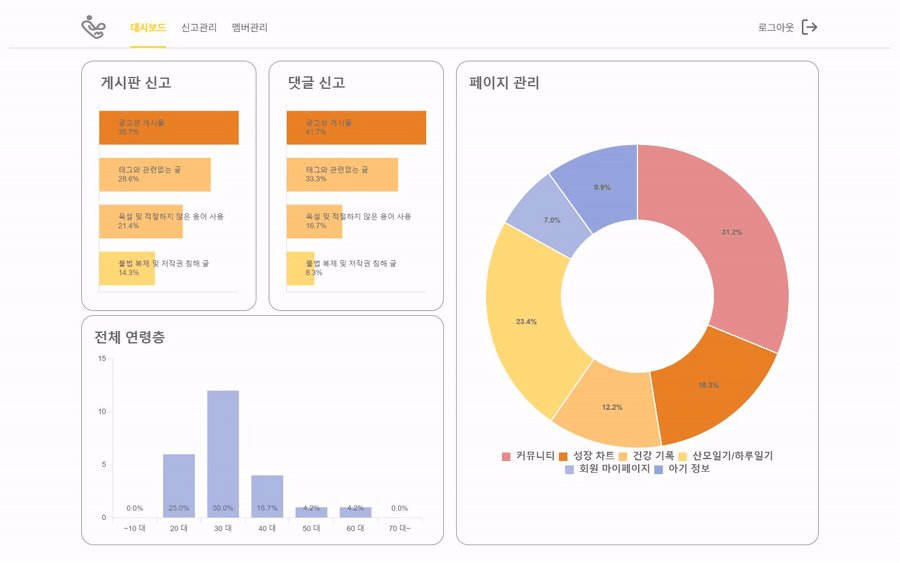
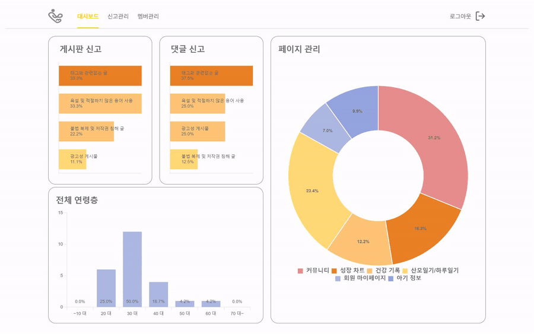

<div align="center">

# 🔔 코코벨 (CoCoBell) — 관리자 서비스

**임신 · 육아 기록 서비스 코코벨을 운영하는 관리자 웹**

서비스 이용 현황을 한눈에 보는 대시보드, 신고된 글 · 댓글 처리, 회원 관리



</div>

<br>

## 1. 프로젝트 소개

**코코벨**은 임신부터 육아까지 아기의 기록을 가족이 함께 남기는 웹 서비스입니다(산모수첩 · 하루일기 · 성장차트 · 건강 체크리스트 · 상담 챗봇 · 부모 커뮤니티).
이 저장소는 그중 **관리자 서비스**로, 사용자 서비스와 같은 DB를 보며 운영 현황을 확인하고 신고와 회원을 관리합니다.

| 항목 | 내용 |
| :--- | :--- |
| 기간 | 2025.11.17 ~ 2025.12.11 (약 4주, 코코벨 전체) |
| 구성 | 관리자 화면 [CS_3_Admin_React](https://github.com/jaann20914-eng/CS_3_Admin_React) + 관리자 API [CS_3_Admin_Boot](https://github.com/jaann20914-eng/CS_3_Admin_Boot) |
| 사용자 서비스 | [CS_3_Client_Boot](https://github.com/jaann20914-eng/CS_3_Client_Boot) — 코코벨 전체 소개와 사용자 화면은 이쪽 README에 있습니다 |

<br>

---

## 2. 서비스 구성



```text
코코벨 관리자
├── 로그인        관리자 계정 로그인 (JWT)
├── 대시보드      게시판 신고 유형 · 댓글 신고 유형 · 회원 연령대 · 페이지별 방문 비율
├── 신고관리      게시판 / 댓글 탭 · 신고 많은 순 목록 · 상세 · 삭제
└── 멤버관리      회원 목록(페이지) · 회원 정보 · 강제 탈퇴
```

| 화면 | 관리자 API | 내용 |
| :--- | :--- | :--- |
| 로그인 | `POST /admin/login` | 관리자 아이디 · 비밀번호 확인 후 JWT 발급 |
| 대시보드 | `GET /dash/boardReportList` · `commentReportList` · `ageGroup` · `pathList` | 신고 유형별 건수, 연령대별 회원 수, 메뉴별 방문 수 |
| 신고관리 | `GET /report/boardList` · `boardDetail` · `commentList` · `commentDetail` | 신고된 글 · 댓글과 신고 사유 |
| 멤버관리 | `GET /user/userList` · `POST /user/secession` | 회원 목록, 강제 탈퇴 |

<br>

---

## 3. 주요 화면

> 화면은 저장소 코드를 로컬에서 실제로 실행해 녹화했습니다. 저장소에 DB 스크립트가 없어 사용자 서비스와 같은 MySQL 테이블에 관리자 계정과 예시 데이터(가상의 회원 · 신고)를 넣었습니다.

### 3.1 대시보드



- **게시판 신고 · 댓글 신고**: 신고 유형(광고성 · 주제와 무관 · 욕설 · 저작권)별 비율을 가로 막대로 보여 주고, 가장 많은 유형을 진한 색으로 강조합니다.
- **전체 연령층**: 회원 생년월일로 나이를 계산해 10살 단위로 묶은 막대 그래프입니다.
- **페이지 관리**: 사용자 화면에서 메뉴를 이동할 때마다 방문 수를 쌓아 두고(`dash_chart`), 메뉴별 비율을 도넛 그래프로 보여 줍니다.

### 3.2 신고관리



- 게시판 / 댓글 탭으로 나누고, **신고 횟수가 많은 순**으로 보여 줍니다.
- 글은 상세 화면에서 본문과 신고 사유를, 댓글은 모달에서 확인하고 **삭제**합니다.
- 삭제는 관리자 화면이 **사용자 서비스의 WebSocket(STOMP)** 으로 요청을 보내고, 사용자 API가 글 · 댓글과 신고 기록을 지운 뒤 작성자에게 알림을 남깁니다.

### 3.3 멤버관리



- 회원을 10명씩 페이지로 보고, 행을 누르면 아이디 · 닉네임 · 이메일 · 생일 · 연락처 모달이 열립니다.
- 문제가 있는 회원은 **강제 탈퇴**합니다.

<br>

---

## 4. 구현 포인트

### 4.1 대시보드 통계는 SQL에서 바로 집계

```sql
-- 신고 유형별 건수 (게시판 / 댓글은 board_seq · comment_seq 로 구분)
SELECT report_type, COUNT(*) AS count FROM report
WHERE board_seq IS NOT NULL GROUP BY report_type ORDER BY count DESC;

-- 연령대: 생년월일 → 만 나이 → 10살 단위 구간
CASE WHEN FLOOR(DATEDIFF(CURDATE(), birth_date) / 365.25) BETWEEN 20 AND 29 THEN '20 대' ... END
```

- 화면은 받은 집계를 chart.js(막대 · 도넛) + datalabels로 그리기만 합니다. (`dash-mapper.xml`, `src/admin/dashboard/*`)

### 4.2 삭제는 사용자 서비스의 알림 통로로

```text
관리자 화면 ──STOMP /pub/admin/notify/send/board {글 번호}──▶ 사용자 API (NotifyController)
                                                          ├─ 신고 기록 · 글 삭제
                                                          └─ 작성자에게 "관리자가 삭제" 알림 저장 · 전송
```

- 관리자 화면은 로그인 때 받은 토큰으로 사용자 서비스의 WebSocket에 연결합니다(`src/webSocket/connectWebSocket.js`). 두 API가 같은 JWT 키를 써서 사용자 쪽에서도 관리자 토큰을 검증합니다.
- 덕분에 삭제와 작성자 알림이 한 곳(사용자 API)에서 처리되고, 작성자가 접속 중이면 바로 알림을 받습니다.

<br>

---

## 5. 기술 스택

| 분류 | 기술 |
| :--- | :--- |
| **Frontend** | React 19.2, React Router 7, zustand, axios, chart.js 4 + react-chartjs-2 + chartjs-plugin-datalabels, SockJS + STOMP |
| **Backend** | Java 21, Spring Boot 3.5, Spring Security + JWT(java-jwt), MyBatis 3 |
| **Database** | MySQL (사용자 서비스와 같은 DB) |
| **배포** | Firebase Hosting(화면), Cloud Run(API) |

<br>

---

## 6. 팀원

| 이름 | 담당 |
| :-: | :--- |
| [dayun-50](https://github.com/dayun-50) | 관리자 API 전체(로그인 · 대시보드 · 신고 · 회원), 관리자 로그인 · 회원 관리 화면, 삭제 WebSocket 연동 |
| [tmd0487](https://github.com/tmd0487) | 관리자 대시보드 · 신고관리 · 멤버관리 화면과 스타일 |
| [박지원](https://github.com/jaann20914-eng) | 사용자 서비스 담당 — 커뮤니티 게시판 · 산모수첩 · 하루일기 ([CS_3_Client_Boot](https://github.com/jaann20914-eng/CS_3_Client_Boot)) |
| [Fuigang](https://github.com/Fuigang) · [장영서](https://github.com/jangyeongseo) | 사용자 서비스 |

> 이 저장소는 팀 원본 저장소를 fork한 것입니다. 코드는 그대로 두고 README만 정리했습니다.
